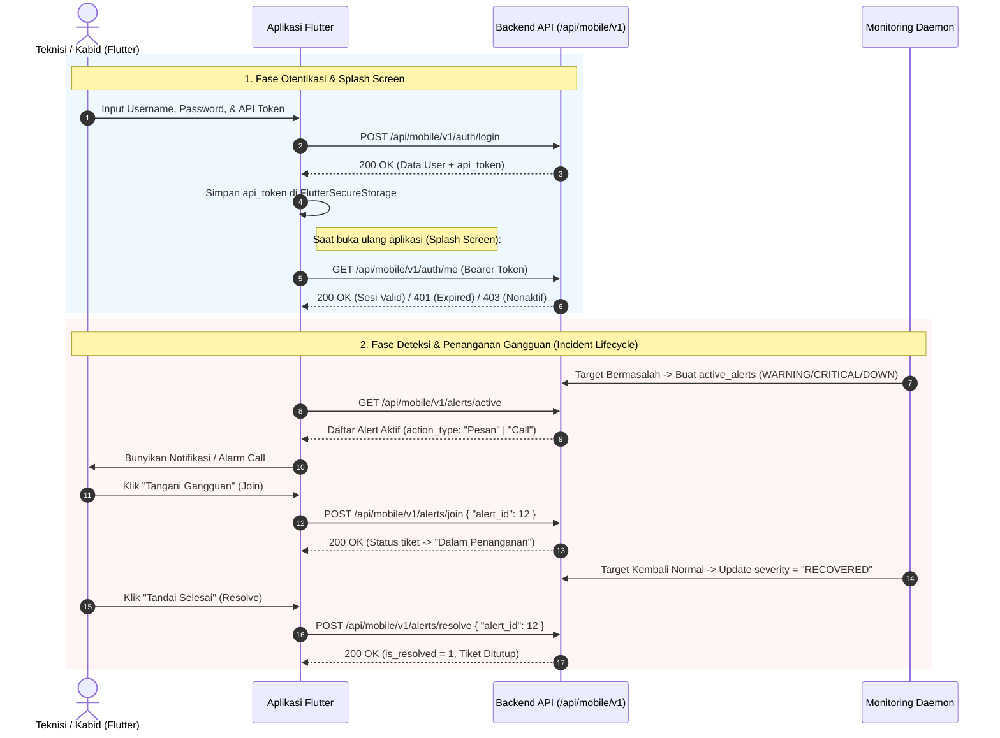

# Analisis & Peta Dokumentasi API Mobile (Flutter) — ProxView Mobile

Dokumen ini berisi hasil analisis kesiapan backend untuk aplikasi mobile serta **Peta API Lengkap (API Blueprint)** sebagai panduan utama pengembangan aplikasi menggunakan **Flutter**.

---

## 1. Hasil Analisis Kelengkapan API Mobile

Berdasarkan audit kode pada [`server.js`](file:///F:/helper-api-proxview/src/backend/server.js), [`authMiddleware.js`](file:///F:/helper-api-proxview/src/backend/middlewares/authMiddleware.js), dan seluruh controller di `src/backend/controllers/`, **API untuk kebutuhan aplikasi Mobile sudah SANGAT PAS, LENGKAP, dan SIAP DIGUNAKAN (Production-Ready)**.

### Mengapa Sudah Pas & Lengkap?
1. **Namespace Khusus & Terisolasi (`/api/mobile/v1/*`)**:
   Semua endpoint mobile sudah dikelompokkan rapi di bawah prefix `/api/mobile/v1/` dan dilindungi oleh middleware [`verifyApiToken`](file:///F:/helper-api-proxview/src/backend/middlewares/authMiddleware.js#L4-L62).
2. **Keamanan Otentikasi 3-Faktor & Validasi Sesi Otomatis**:
   - Endpoint [`POST /api/mobile/v1/auth/login`](file:///F:/helper-api-proxview/src/backend/controllers/authController.js#L124-L208) memvalidasi 3 faktor sekaligus: `username`, `password` (bcrypt), dan `token` (API Token dari Web Admin).
   - Mendukung pengecekan status aktif akun (`is_active`) dan masa kedaluwarsa token (`token_expires_at` hingga akhir hari 23:59:59 WIB).
   - Tersedia endpoint [`GET /api/mobile/v1/auth/me`](file:///F:/helper-api-proxview/src/backend/server.js#L131-L133) untuk **Auto-Login / Cek Sesi pada Splash Screen Flutter**.
3. **Pemisahan Hak Akses (Role-Based Architecture)**:
   - Di [`userController.js`](file:///F:/helper-api-proxview/src/backend/controllers/userController.js#L45-L48), `api_token` secara spesifik di-generate untuk role **`Teknisi`** dan **`Kepala Bidang`** (sedangkan `Admin` menggunakan Web Dashboard).
   - Seluruh operasi konfigurasi sensitif (CRUD user, tambah/hapus target, ubah threshold) dibatasi untuk Web Admin, sedangkan API Mobile difokuskan pada **Monitoring Real-time, Analitik SLA (ITIL), serta Aksi Penanganan Insiden (Join & Resolve)**.
4. **Dukungan Penuh Siklus Hidup Insiden (Alert & Ticketing State Machine)**:
   - Notifikasi aktif menyediakan field `action_type` (`"Pesan"` atau `"Call"`), sehingga Flutter dapat membedakan kapan harus menampilkan **Push Notification biasa** vs **Full-Screen Incoming Call Alarm** (dering telepon darurat).
   - Endpoint Join & Resolve sudah pintar: otomatis membaca identitas teknisi (`id` dan `name`) langsung dari **Bearer Token** tanpa wajib mengirim `user_id`/`user_name` manual di body.
   - Validasi penutupan tiket sudah dikunci di backend: teknisi hanya bisa menekan **Selesai (Resolve)** apabila sistem daemon sudah mendeteksi target pulih (`severity === 'RECOVERED'`).

> [!TIP]
> **Catatan Arsitektur Notifikasi di Flutter**:
> Saat ini backend menggunakan mekanisme pengambilan data aktif (`GET /api/mobile/v1/alerts/active`). Di Flutter, gunakan kombinasi `Timer.periodic` (saat aplikasi dibuka) dan `flutter_background_service` (saat aplikasi di background) yang melakukan polling tiap 5–10 detik. Jika ditemukan `id` alert baru atau perubahan `severity`, picu `flutter_local_notifications` (untuk `action_type == "Pesan"`) atau `flutter_callkit_incoming` / halaman alarm khusus (untuk `action_type == "Call"`).

---

## 2. Alur Kerja Aplikasi Mobile (Workflow Diagram)



---

## 3. Konfigurasi Dasar HTTP Client (Flutter)

### Base URL & Header Standar
Semua endpoint di bawah (kecuali `/auth/login`) **WAJIB** menyertakan header `Authorization: Bearer <api_token>`.

```http
Content-Type: application/json
Accept: application/json
Authorization: Bearer <64_karakter_hex_api_token>
```

### Standar Kode Status HTTP & Penanganan Error
| Status Code | Kondisi | Penanganan di Flutter |
| :--- | :--- | :--- |
| `200 OK` | Request berhasil | Proses properti `data` dari JSON response |
| `400 Bad Request` | Parameter kurang / Tiket belum berstatus `RECOVERED` saat di-resolve | Tampilkan pesan `message` dari server via `SnackBar` / Dialog |
| `401 Unauthorized` | Token tidak valid / kosong / **sudah kedaluwarsa (`token_expires_at`)** | Hapus token dari storage lokal & arahkan paksa ke halaman **Login** |
| `403 Forbidden` | Akun dinonaktifkan (`is_active == 0`) oleh Admin | Hapus sesi & tampilkan peringatan bahwa akun sedang dinonaktifkan |
| `404 Not Found` | ID Target / Node / Tiket tidak ditemukan | Tampilkan pesan error |
| `500 Internal Error` | Kesalahan database / Node Proxmox tidak merespon | Tampilkan state *Retry* |

---

## 4. Peta Lengkap Endpoint API Mobile (`/api/mobile/v1`)

Berikut adalah ringkasan seluruh **20 endpoint** yang tersedia untuk aplikasi Flutter:

| Kategori | Method | Endpoint | Deskripsi Singkat |
| :--- | :---: | :--- | :--- |
| **1. Auth & Sesi** | `POST` | `/api/mobile/v1/auth/login` | Login 3-Faktor (Username, Password, Token) |
| | `GET` | `/api/mobile/v1/auth/me` | Cek validitas token & profil user aktif (Splash Screen) |
| **2. Dashboard** | `GET` | `/api/mobile/v1/system/status` | Indikator global (`ACTIVE`/`DOWN`) Proxmox, ICMP, TCP |
| | `GET` | `/api/mobile/v1/dashboard` | Ringkasan metrik utama, grafik RRD cluster, & 10 insiden terbaru |
| **3. Alert & Tiket** | `GET` | `/api/mobile/v1/alerts/active` | Daftar notifikasi gangguan yang sedang aktif (`is_resolved = 0`) |
| | `GET` | `/api/mobile/v1/alerts/history` | Riwayat gangguan yang sudah selesai (`is_resolved = 1`) |
| | `POST` | `/api/mobile/v1/alerts/join` | Konfirmasi teknisi mulai menangani gangguan (Join Tiket) |
| | `POST` | `/api/mobile/v1/alerts/resolve` | Menutup tiket gangguan setelah status `RECOVERED` |
| | `GET` | `/api/mobile/v1/incidents` | Daftar lengkap seluruh tiket (`#INC-YYYY-XXXX`) + durasi |
| | `GET` | `/api/mobile/v1/incidents/stats` | Ringkasan statistik status insiden (`down`, `critical`, `warning`, `progress`, `resolved`) |
| | `POST` | `/api/mobile/v1/incidents/join` | Alias dari `/alerts/join` |
| | `POST` | `/api/mobile/v1/incidents/resolve` | Alias dari `/alerts/resolve` |
| **4. Analitik SLA** | `GET` | `/api/mobile/v1/analytics` | Metrik ITIL SLA (Uptime, Downtime, MTTR, Availability, Grafik) |
| **5. Network (ICMP/TCP)**| `GET` | `/api/mobile/v1/targets` | Daftar seluruh target monitoring ICMP Ping & TCP Socket |
| | `GET` | `/api/mobile/v1/targets/:id/history`| 20 riwayat latency terakhir untuk grafik per target |
| **6. Proxmox VE** | `GET` | `/api/mobile/v1/proxmox` | Daftar server/cluster Proxmox yang terdaftar |
| | `GET` | `/api/mobile/v1/proxmox/:id/status` | Statistik mendalam tiap node fisik (CPU, RAM, IO, Load, Net) |
| | `GET` | `/api/mobile/v1/proxmox/:id/resources`| Daftar seluruh VM (`qemu`), Container (`lxc`), & `storages` |
| **7. Log & Audit** | `GET` | `/api/mobile/v1/proxmox/logs/tasks` | Daftar riwayat task Proxmox cluster |
| | `GET` | `/api/mobile/v1/proxmox/logs/cluster`| 500 baris syslog/cluster log terakhir dari Proxmox |
| | `GET` | `/api/mobile/v1/proxmox/logs/task-detail`| Isi log terminal per task (`?node=...&upid=...`) |
| | `GET` | `/api/mobile/v1/logs/system` | Log sistem internal & jejak audit (`?limit=200`) |

---

## 5. Detail Spesifikasi Endpoint & Contoh Payload JSON

### A. Modul Otentikasi & Sesi

#### 1. Login Mobile (3-Faktor)
- **Endpoint**: `POST /api/mobile/v1/auth/login`
- **Auth**: Tidak perlu Bearer Token
- **Controller**: [`mobileLogin`](file:///F:/helper-api-proxview/src/backend/controllers/authController.js#L124-L208)
- **Request Body**:
```json
{
  "username": "sainzlab",
  "password": "password123",
  "token": "a1b2c3d4e5f6...64_hex_chars"
}
```
- **Response Sukses (`200 OK`)**:
```json
{
  "success": true,
  "message": "Otentikasi berhasil. Perangkat terhubung.",
  "data": {
    "id": 5,
    "name": "Budi Teknisi",
    "username": "sainzlab",
    "role": "Teknisi",
    "api_token": "a1b2c3d4e5f6...64_hex_chars"
  }
}
```

#### 2. Cek Profil & Validasi Sesi Aktif
- **Endpoint**: `GET /api/mobile/v1/auth/me`
- **Auth**: Wajib `Bearer <token>`
- **Response Sukses (`200 OK`)**:
```json
{
  "success": true,
  "data": {
    "id": 5,
    "name": "Budi Teknisi",
    "username": "sainzlab",
    "role": "Teknisi",
    "is_active": 1,
    "token_expires_at": "2026-12-31T00:00:00.000Z"
  }
}
```

---

### B. Modul Dashboard & Status Global

#### 3. Status Konektivitas Global
- **Endpoint**: `GET /api/mobile/v1/system/status`
- **Controller**: [`getSystemStatus`](file:///F:/helper-api-proxview/src/backend/controllers/targetController.js#L163-L189)
- **Response (`200 OK`)**:
```json
{
  "success": true,
  "data": {
    "proxmox": "ACTIVE",
    "icmp": "ACTIVE",
    "tcp": "DOWN"
  }
}
```

#### 4. Ringkasan Dashboard Utama
- **Endpoint**: `GET /api/mobile/v1/dashboard?timeframe=1h`
- **Query Params**: `timeframe` (opsional: `1h` [default], `24h`, `7d`)
- **Controller**: [`getDashboardSummary`](file:///F:/helper-api-proxview/src/backend/controllers/dashboardController.js#L213-L333)
- **Response (`200 OK`)**:
```json
{
  "success": true,
  "data": {
    "users": {
      "total": 8,
      "active": 7,
      "active_roles": 3
    },
    "proxmox": {
      "total_nodes": 2,
      "online_nodes": 2,
      "offline_nodes": 0,
      "health_percent": 100,
      "total_vms": 14,
      "running_vms": 12,
      "avg_cpu": 24.5,
      "avg_ram": 61.2,
      "avg_io": 0.45,
      "node_names": ["pve-node1", "pve-node2"],
      "chart": {
        "labels": ["18:00", "18:05", "18:10"],
        "cpu": [22.1, 25.0, 24.5],
        "ram": [60.8, 61.0, 61.2],
        "io": [0.3, 0.5, 0.45]
      }
    },
    "icmp": {
      "total": 10,
      "active": 10,
      "up": 9,
      "down": 1,
      "avg_latency_ms": 14.2
    },
    "tcp": {
      "total": 6,
      "active": 6,
      "up": 6,
      "down": 0,
      "avg_latency_ms": 8.5
    },
    "recent_incidents": [
      {
        "id": 76,
        "ticket_id": "#INC-2026-0076",
        "time": "2026-10-22T11:20:00.000Z",
        "resolved_at": null,
        "target_type": "NETWORK",
        "target_name": "Core Router Utama",
        "component": "NETWORK - Core Router Utama",
        "severity": "DOWN",
        "original_severity": "DOWN",
        "message": "Koneksi Timeout / Terputus (3x RTO berturut-turut)",
        "is_resolved": false,
        "status_label": "INVESTIGASI",
        "technicians": "Budi Teknisi"
      }
    ]
  }
}
```

---

### C. Modul Notifikasi Gangguan (Alerts) & Penanganan Insiden (Ticketing)

#### Memahami Status & Severity Alert di Flutter
| Field | Nilai yang Mungkin | Arti untuk UI Flutter |
| :--- | :--- | :--- |
| `severity` | `WARNING` | Kuning/Amber — Melewati batas warning (CPU/RAM/IO/Latency) |
| | `CRITICAL` | Oranye — Melewati batas kritis |
| | `DOWN` | Merah — Target mati/terputus/stopped |
| | `RECOVERED` | Hijau/Biru — **Target sudah kembali normal**, menunggu Teknisi menekan tombol **Resolve (Selesai)** |
| `action_type` | `Pesan` | Tampilkan sebagai notifikasi standar (suara notifikasi pendek) |
| | `Call` | Tampilkan sebagai **Panggilan Darurat / Full-Screen Alarm** |
| `handler_count` | `0` | Status: **Gangguan Aktif (Belum Ditangani)** -> Tampilkan tombol **"Tangani (Join)"** |
| | `> 0` | Status: **Dalam Penanganan** -> Jika `severity == 'RECOVERED'`, aktifkan tombol **"Tandai Selesai (Resolve)"** |

#### 5. Tarik Alert Aktif
- **Endpoint**: `GET /api/mobile/v1/alerts/active`
- **Controller**: [`getActiveAlerts`](file:///F:/helper-api-proxview/src/backend/controllers/mobileAlertController.js#L4-L29)
- **Response (`200 OK`)**:
```json
{
  "success": true,
  "total_active": 1,
  "data": [
    {
      "id": 76,
      "target_id": 4,
      "target_type": "NETWORK",
      "target_name": "Core Router Utama",
      "severity": "DOWN",
      "original_severity": "DOWN",
      "action_type": "Call",
      "message": "Koneksi Timeout / Terputus (3x RTO berturut-turut)",
      "is_resolved": 0,
      "created_at": "2026-10-22T11:20:00.000Z",
      "resolved_at": null,
      "technicians": "Budi Teknisi",
      "handler_count": 1,
      "handled_at": "2026-10-22T11:21:15.000Z"
    }
  ]
}
```

#### 6. Tarik Riwayat Alert Selesai
- **Endpoint**: `GET /api/mobile/v1/alerts/history?limit=100`
- **Query Params**: `limit` (opsional, default `100`, maks `500`)
- **Controller**: [`getAlertHistory`](file:///F:/helper-api-proxview/src/backend/controllers/mobileAlertController.js#L33-L59)
- **Response (`200 OK`)**: Struktur sama dengan `/alerts/active` namun berisi tiket dengan `is_resolved: 1` dan `total`.

#### 7. Teknisi Join / Konfirmasi Penanganan Tiket
- **Endpoint**: `POST /api/mobile/v1/alerts/join` (atau `POST /api/mobile/v1/incidents/join`)
- **Controller**: [`joinIncident`](file:///F:/helper-api-proxview/src/backend/controllers/incidentController.js#L81-L115)
- **Request Body** *(Catatan: `user_id` dan `user_name` otomatis diambil dari Bearer Token jika tidak dikirim)*:
```json
{
  "alert_id": 76
}
```
- **Response Sukses (`200 OK`)**:
```json
{
  "success": true,
  "message": "Berhasil bergabung dalam penanganan tiket"
}
```

#### 8. Teknisi Menutup Tiket (Resolve)
- **Endpoint**: `POST /api/mobile/v1/alerts/resolve` (atau `POST /api/mobile/v1/incidents/resolve`)
- **Controller**: [`resolveIncident`](file:///F:/helper-api-proxview/src/backend/controllers/incidentController.js#L120-L155)
- **Syarat Backend**: Hanya berhasil jika `severity` pada alert tersebut sudah bernilai `'RECOVERED'`. Jika target masih bermasalah, backend mengembalikan `400 Bad Request`.
- **Request Body**:
```json
{
  "alert_id": 76
}
```
- **Response Sukses (`200 OK`)**:
```json
{
  "success": true,
  "message": "Tiket berhasil ditandai selesai"
}
```
- **Response Gagal Bila Belum Pulih (`400 Bad Request`)**:
```json
{
  "success": false,
  "message": "Gagal! Sistem masih mendeteksi adanya gangguan. Pastikan indikator sistem kembali normal sebelum menutup tiket."
}
```

#### 9. Daftar Rekap Seluruh Tiket Insiden
- **Endpoint**: `GET /api/mobile/v1/incidents`
- **Controller**: [`getIncidents`](file:///F:/helper-api-proxview/src/backend/controllers/incidentController.js#L28-L76)
- **Response (`200 OK`)**:
```json
{
  "success": true,
  "data": [
    {
      "id": "#INC-2026-0076",
      "db_id": 76,
      "time": "2026-10-22T11:20:00.000Z",
      "resolved_at": null,
      "title": "Koneksi Timeout / Terputus (3x RTO berturut-turut)",
      "target": "NETWORK - Core Router Utama",
      "status": "Dalam Penanganan",
      "severity": "RECOVERED",
      "original_severity": "DOWN",
      "technicians": "Budi Teknisi",
      "is_resolved": 0,
      "downtime_duration": "12m 30d",
      "handling_duration": "11m 15d"
    }
  ]
}
```
*(Catatan: Gunakan `db_id` ketika memanggil endpoint `/join` atau `/resolve`).*

---

### D. Modul Analitik Kinerja Sistem (ITIL SLA)

#### 10. Ambil Analitik SLA & Grafik Kinerja
- **Endpoint**: `GET /api/mobile/v1/analytics?period=24h&severity=ALL`
- **Query Params**:
  - `period`: `24h` (default, per jam), `7d` (per hari), `30d` (per hari)
  - `severity`: `ALL` (default), `DOWN`, `CRITICAL`, `WARNING`
- **Controller**: [`getAnalytics`](file:///F:/helper-api-proxview/src/backend/controllers/incidentController.js#L202-L273)
- **Response (`200 OK`)**:
```json
{
  "success": true,
  "summary": {
    "period": "24h",
    "severity": "ALL",
    "total_period_sec": 86400,
    "total_uptime_sec": 85800,
    "total_downtime_sec": 600,
    "incident_count": 2,
    "mttr_sec": 300,
    "availability": "99.31"
  },
  "chartData": [
    {
      "label": "17:00",
      "total_period_sec": 3600,
      "total_uptime_sec": 3600,
      "total_downtime_sec": 0,
      "incident_count": 0,
      "mttr_sec": 0,
      "availability": "100.00"
    }
  ]
}
```

---

### E. Modul Monitoring Network (ICMP Ping & TCP Socket)

#### 11. Daftar Target Network
- **Endpoint**: `GET /api/mobile/v1/targets`
- **Controller**: [`getTargets`](file:///F:/helper-api-proxview/src/backend/controllers/targetController.js#L18-L26)
- **Response (`200 OK`)**:
```json
{
  "success": true,
  "data": [
    {
      "id": 4,
      "name": "Core Router Utama",
      "description": "Gateway lantai 2",
      "protocol": "ICMP PING",
      "ip_address": "192.168.1.1",
      "port": null,
      "check_interval": 10,
      "max_retries": 3,
      "status": "UP",
      "last_latency": "4 ms",
      "is_active": 1,
      "is_alert_enabled": 1,
      "latency_warning": 50,
      "latency_critical": 150,
      "last_check": "2026-10-22T11:50:00.000Z"
    }
  ]
}
```

#### 12. Grafik Riwayat Latency Target (20 Titik Terakhir)
- **Endpoint**: `GET /api/mobile/v1/targets/:id/history`
- **Controller**: [`getTargetHistory`](file:///F:/helper-api-proxview/src/backend/controllers/targetController.js#L138-L158)
- **Response (`200 OK`)**:
```json
{
  "success": true,
  "data": [
    {
      "latency_ms": 4,
      "status": "UP",
      "time": "2026-10-22T11:49:50Z"
    },
    {
      "latency_ms": 5,
      "status": "UP",
      "time": "2026-10-22T11:50:00Z"
    }
  ]
}
```

---

### F. Modul Monitoring Proxmox VE (Node, VM, LXC, Storage & Logs)

#### 13. Daftar Server/Cluster Proxmox Terdaftar
- **Endpoint**: `GET /api/mobile/v1/proxmox`
- **Controller**: [`getProxmoxNodes`](file:///F:/helper-api-proxview/src/backend/controllers/proxmoxController.js#L49-L56)
- **Response (`200 OK`)**:
```json
{
  "success": true,
  "data": [
    {
      "id": 1,
      "name": "Cluster Datacenter Utama",
      "hostUrl": "https://10.10.10.2:8006",
      "tokenId": "root@pam!monitoring",
      "status": "TERHUBUNG",
      "latency": "12 ms",
      "pveVersion": "8.2.2"
    }
  ]
}
```
*(Gunakan `id` dari response ini sebagai parameter `:id` pada endpoint `/proxmox/:id/status` dan `/proxmox/:id/resources`).*

#### 14. Status Mendalam Node Fisik Proxmox
- **Endpoint**: `GET /api/mobile/v1/proxmox/:id/status`
- **Controller**: [`getProxmoxNodeStatus`](file:///F:/helper-api-proxview/src/backend/controllers/proxmoxController.js#L214-L317)
- **Response (`200 OK`)**:
```json
{
  "success": true,
  "data": [
    {
      "node_name": "pve-node1",
      "status": "online",
      "cpu_usage": "18.4 %",
      "cpu_cores": 16,
      "cpu_model": "Intel(R) Xeon(R) Gold 6226R CPU @ 2.90GHz",
      "ram_used": "24.5 GB",
      "ram_total": "64 GB",
      "ram_percentage": "38.3 %",
      "io_delay": "0.12 %",
      "load_average": "1.12, 1.05, 0.98",
      "uptime": "45h 12j 30m",
      "network_traffic": {
        "rx_in": "1.25 MB/s",
        "tx_out": "840.5 KB/s"
      }
    }
  ]
}
```

#### 15. Daftar Resources Proxmox (VM, LXC, & Storage)
- **Endpoint**: `GET /api/mobile/v1/proxmox/:id/resources`
- **Controller**: [`getProxmoxResources`](file:///F:/helper-api-proxview/src/backend/controllers/proxmoxController.js#L148-L209)
- **Response (`200 OK`)**:
```json
{
  "success": true,
  "data": {
    "vms": [
      {
        "vmid": 101,
        "name": "prod-db-server",
        "node": "pve-node1",
        "status": "running",
        "cpu_usage": "14.2 %",
        "cpu_cores": 4,
        "ram_used": "6.2 GB",
        "ram_total": "8 GB",
        "ram_percentage": "77.5 %",
        "disk_used": "0 B",
        "disk_total": "100 GB",
        "uptime": "12h 4j 10m",
        "net_in": "45.2 GB",
        "net_out": "12.8 GB"
      }
    ],
    "lxcs": [
      {
        "vmid": 201,
        "name": "nginx-reverse-proxy",
        "node": "pve-node1",
        "status": "running",
        "cpu_usage": "2.1 %",
        "cpu_cores": 2,
        "ram_used": "512 MB",
        "ram_total": "2 GB",
        "ram_percentage": "25.0 %",
        "disk_used": "4.1 GB",
        "disk_total": "20 GB",
        "uptime": "30h 2j 15m",
        "net_in": "120 GB",
        "net_out": "118 GB"
      }
    ],
    "storages": [
      {
        "storage": "local-lvm",
        "node": "pve-node1",
        "type": "lvmthin",
        "used": "450.5 GB",
        "total": "1.8 TB"
      }
    ]
  }
}
```

#### 16. Log Proxmox & Log Sistem Internal
- **`GET /api/mobile/v1/proxmox/logs/tasks`**: Mengembalikan daftar task cluster dari Proxmox (`upid`, `node`, `type`, `user`, `status`, `starttime`, `endtime`).
- **`GET /api/mobile/v1/proxmox/logs/cluster`**: Mengembalikan 500 baris log cluster Proxmox (`time`, `node`, `pri`, `tag`, `msg`).
- **`GET /api/mobile/v1/proxmox/logs/task-detail?node=<nama_node>&upid=<upid_task>`**: Mengembalikan array baris terminal `[{ "n": 1, "t": "TASK OK" }]`.
- **`GET /api/mobile/v1/logs/system?limit=200`**: Mengembalikan log audit internal ProxView:
```json
{
  "success": true,
  "total": 450,
  "data": [
    {
      "id": 1024,
      "level": "INFO",
      "source": "TICKET SYSTEM",
      "message": "Teknisi Budi Teknisi mengkonfirmasi penanganan tiket #76",
      "timestamp": "2026-10-22T11:21:15Z"
    }
  ]
}
```

---

## 6. Starter Template Kode Flutter (Siap Pakai)

Berikut adalah contoh implementasi `ApiClient` (menggunakan package `dio` dan `flutter_secure_storage`) beserta pemetaan endpoint yang bisa langsung dipasang di project Flutter Anda:

```dart
import 'package:dio/dio.dart';
import 'package:flutter_secure_storage/flutter_secure_storage.dart';

class ProxViewApiService {
  // Ganti dengan IP/Domain server ProxView Anda
  // (Gunakan 10.0.2.2:3000 jika menggunakan Android Emulator lokal)
  static const String baseUrl = 'http://192.168.1.100:3000/api/mobile/v1';

  final Dio _dio = Dio(BaseOptions(
    baseUrl: baseUrl,
    connectTimeout: const Duration(seconds: 10),
    receiveTimeout: const Duration(seconds: 15),
    headers: {'Content-Type': 'application/json'},
  ));

  final FlutterSecureStorage _storage = const FlutterSecureStorage();

  ProxViewApiService() {
    _dio.interceptors.add(InterceptorsWrapper(
      onRequest: (options, handler) async {
        // Otomatis sisipkan Bearer Token di setiap request (kecuali login)
        if (!options.path.contains('/auth/login')) {
          final token = await _storage.read(key: 'api_token');
          if (token != null && token.isNotEmpty) {
            options.headers['Authorization'] = 'Bearer $token';
          }
        }
        return handler.next(options);
      },
      onError: (DioException e, handler) async {
        // Jika 401 (Token Expired / Invalid) atau 403 (Akun Dinonaktifkan)
        if (e.response?.statusCode == 401 || e.response?.statusCode == 403) {
          await _storage.deleteAll();
          // TODO: Navigasi paksa ke LoginScreen
        }
        return handler.next(e);
      },
    ));
  }

  // 1. Login 3-Faktor
  Future<Map<String, dynamic>> login({
    required String username,
    required String password,
    required String token,
  }) async {
    final res = await _dio.post('/auth/login', data: {
      'username': username,
      'password': password,
      'token': token,
    });
    if (res.data['success'] == true) {
      await _storage.write(key: 'api_token', value: res.data['data']['api_token']);
    }
    return res.data;
  }

  // 2. Cek Sesi (Splash Screen)
  Future<Map<String, dynamic>> getProfile() async {
    final res = await _dio.get('/auth/me');
    return res.data;
  }

  // 3. Dashboard Summary (timeframe: '1h', '24h', '7d')
  Future<Map<String, dynamic>> getDashboard({String timeframe = '1h'}) async {
    final res = await _dio.get('/dashboard', queryParameters: {'timeframe': timeframe});
    return res.data;
  }

  // 4. Tarik Alert Aktif
  Future<List<dynamic>> getActiveAlerts() async {
    final res = await _dio.get('/alerts/active');
    return res.data['data'] ?? [];
  }

  // 5. Join Tiket Gangguan
  Future<Map<String, dynamic>> joinAlert(int alertId) async {
    final res = await _dio.post('/alerts/join', data: {'alert_id': alertId});
    return res.data;
  }

  // 6. Resolve (Selesaikan) Tiket Gangguan
  Future<Map<String, dynamic>> resolveAlert(int alertId) async {
    final res = await _dio.post('/alerts/resolve', data: {'alert_id': alertId});
    return res.data;
  }

  // 7. Rekap Tiket & Analitik SLA
  Future<List<dynamic>> getIncidents() async {
    final res = await _dio.get('/incidents');
    return res.data['data'] ?? [];
  }

  Future<Map<String, dynamic>> getAnalytics({
    String period = '24h',
    String severity = 'ALL',
  }) async {
    final res = await _dio.get('/analytics', queryParameters: {
      'period': period,
      'severity': severity,
    });
    return res.data;
  }

  // 8. Target ICMP & TCP
  Future<List<dynamic>> getTargets() async {
    final res = await _dio.get('/targets');
    return res.data['data'] ?? [];
  }

  Future<List<dynamic>> getTargetHistory(int targetId) async {
    final res = await _dio.get('/targets/$targetId/history');
    return res.data['data'] ?? [];
  }

  // 9. Proxmox Nodes, Status & Resources
  Future<List<dynamic>> getProxmoxServers() async {
    final res = await _dio.get('/proxmox');
    return res.data['data'] ?? [];
  }

  Future<List<dynamic>> getProxmoxNodeStatus(int serverId) async {
    final res = await _dio.get('/proxmox/$serverId/status');
    return res.data['data'] ?? [];
  }

  Future<Map<String, dynamic>> getProxmoxResources(int serverId) async {
    final res = await _dio.get('/proxmox/$serverId/resources');
    return res.data['data'] ?? {};
  }
}
```

note
1. menu analitik grafik Uptime & Downtime ui nya blom konsisten sama MTTR juga